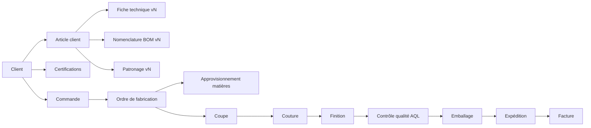

# BUSINESS_RULES — Règles métier

> Statut : v1. Chaque règle a un ID stable (utilisable dans le code et les tests). **[À CONFIRMER]** = hypothèse.

## 1. Architecture métier

Flux principal :

Cycle de vie d'une commande : `brouillon → confirmée → en_production → terminée → expédiée → facturée` (+ `annulée`).

## 2. Cloisonnement par client (règle fondatrice)
- **BR-CLI-001** : Tout article, nomenclature, fiche technique, patronage, certification et document GED appartient à **exactement un client** (`client_id` obligatoire). Exception : documents « internes MB » (`client_id` NULL, `scope = interne`).
- **BR-CLI-002** : Un article ne peut être commandé que par son client propriétaire.
- **BR-CLI-003** : Les références client (code article client, taille, couleur) sont uniques **par client**, pas globalement.
- **BR-CLI-004** : Un utilisateur « client » (portail) ne voit que les données de son client (RLS).
- **BR-CLI-005** : Les matières et fournisseurs sont **partagés** (catalogue MB), mais une BOM peut imposer un fournisseur/référence spécifique au client.
- **BR-CLI-006** : Un client peut fournir sa matière (« client fournit ») : le stock correspondant est tagué `propriete = client` et n'est jamais valorisé ni utilisé pour un autre client.

## 3. Articles, fiches techniques, BOM, patronages
- **BR-ART-001** : Un article = code MB unique + référence client + désignation + famille (veste, pantalon, combinaison, polo, gilet haute visibilité…).
- **BR-ART-002** : Un article possède des **déclinaisons** : couleurs × tailles (grille de tailles liée à l'article).
- **BR-ART-003** : Fiche technique, BOM et patronage sont **versionnés** : `brouillon → en_validation → validée → obsolète`.
- **BR-ART-004** : Seule une version `validée` peut être utilisée en production. Une OF fige la version utilisée (`version_id`).
- **BR-ART-005** : Modifier une version validée est interdit ; on crée une nouvelle version (copie) qui repart en brouillon.
- **BR-ART-006** : La validation d'une fiche technique/BOM exige le rôle « Bureau des méthodes » ; l'**approbation client** (date + document de preuve) est enregistrée si requise par le client **[À CONFIRMER]**.
- **BR-ART-007** : La BOM liste : matière/fourniture, quantité par pièce **par taille** (ou formule), unité, % de perte, fournisseur imposé (optionnel).
- **BR-ART-008** : La fiche technique contient : mesures par taille (tolérances), gammes opératoires (opérations, temps standard SAM), points de contrôle qualité, instructions de marquage/étiquetage, normes visées.
- **BR-ART-009** : Un patronage = fichier(s) (DXF/PLT/PDF) stocké(s) dans Storage, rattaché à une version d'article, avec taille(s) couverte(s) et date de validation.
- **BR-ART-010** : Un article est **activable** seulement s'il a une version validée de fiche technique, BOM et patronage.

## 4. Certifications & conformité
- **BR-CER-001** : Une certification (ex. EN ISO 20471 haute visibilité, EN 11612, EN 1149, OEKO-TEX, REACH, ISO 9001…) est rattachée à un client et/ou un article, avec organisme, n°, date d'émission, **date d'expiration**, document GED. **[À CONFIRMER]** liste exacte.
- **BR-CER-002** : Alertes d'expiration à J-90, J-30, J-7 (notification + tableau de bord).
- **BR-CER-003** : Un article soumis à une norme obligatoire ne peut pas être **expédié** si la certification requise est expirée ou absente (blocage avec dérogation Direction tracée).
- **BR-CER-004** : Les certificats matières (tissus) sont rattachés à la matière/lot et réutilisables par plusieurs articles.

## 5. GED
- **BR-GED-001** : Chaque document a : type (fiche technique, patronage, certificat, rapport d'essai, contrat, photo, BL, facture…), client (ou interne), entité liée (article, commande, OF, certification, inspection…), version, statut, auteur, dates.
- **BR-GED-002** : Les fichiers sont dans des **buckets privés** ; l'accès se fait par URL signée de courte durée, après contrôle RLS.
- **BR-GED-003** : Chemin de stockage normalisé : `{client_id}/{type}/{entité_id}/{version}/{nom_fichier}`.
- **BR-GED-004** : Un document n'est jamais supprimé physiquement s'il est référencé par une OF, une expédition ou une inspection ; il est **archivé**.
- **BR-GED-005** : Hash SHA-256 enregistré pour détecter les doublons et prouver l'intégrité.
- **BR-GED-006** : Types/taille autorisés (PDF, DXF, PLT, images, XLSX, DOCX ; taille max configurable) ; renommage aléatoire côté stockage.

## 6. Commandes
- **BR-CMD-001** : Une commande a un client, des lignes (article + déclinaison couleur/taille + quantité), une date de livraison, une incoterm, une devise.
- **BR-CMD-002** : Confirmation possible seulement si tous les articles sont actifs (BR-ART-010) et certifications requises valides (BR-CER-003).
- **BR-CMD-003** : Après confirmation, modification = **avenant** tracé (qui, quand, avant/après).
- **BR-CMD-004** : Tolérance de livraison ±5 % **[À CONFIRMER]**, paramétrable par client.
- **BR-CMD-005** : Numérotation séquentielle par société et année (`CMD-2026-00042`) générée par fonction SQL atomique.

## 7. Approvisionnement & stock
- **BR-STK-001** : Le stock = somme des **mouvements** immuables (réception, sortie, transfert, retour, ajustement). Aucune mise à jour directe d'un total.
- **BR-STK-002** : Stock jamais négatif (contrainte vérifiée dans la fonction de mouvement).
- **BR-STK-003** : Tissu géré par **lot/rouleau** (métrage, laize, teinte/bain) ; fournitures par lot ou en vrac.
- **BR-STK-004** : Besoins matières d'une OF = Σ(quantités BOM × quantités par taille × (1 + perte %)). Réservation à la confirmation de l'OF.
- **BR-STK-005** : Sortie de matière à la **coupe**, avec consommation réelle comparée au standard ; écart > 3 % signalé **[À CONFIRMER]**.
- **BR-STK-006** : Un ajustement d'inventaire exige un motif ; au-dessus d'un seuil, approbation Responsable/Direction.
- **BR-STK-007** : Matière à teinte différente : interdiction de mélanger deux bains dans un même lot de coupe sans autorisation Qualité.
- **BR-ACH-001** : Une commande fournisseur peut être générée depuis les besoins non couverts ; réception partielle autorisée ; écarts quantité/prix signalés.

## 8. Production
- **BR-PRO-001** : OF rattaché à une ligne de commande, une version validée (fiche technique/BOM/patronage), une répartition par taille/couleur.
- **BR-PRO-002** : Étapes standard : `coupe → couture → finition → contrôle → emballage`. Modèle d'étapes paramétrable par famille d'article.
- **BR-PRO-003** : L'OF est découpée en **lots/paquets** avec code-barres unique ; chaque passage d'étape est un événement horodaté (qui, où, quantité bonne/rebut).
- **BR-PRO-004** : Saut d'étape interdit sans approbation du chef d'atelier.
- **BR-PRO-005** : La production d'une étape ne peut pas dépasser la quantité reçue de l'étape précédente (± rebuts déclarés).
- **BR-PRO-006** : Rendement par opérateur/opération calculé à partir des événements et des temps standard (SAM).
- **BR-PRO-007** : Sous-traitance (broderie, sérigraphie, lavage) = étape externe avec bon d'envoi/retour et suivi des quantités.

## 9. Qualité
- **BR-QUA-001** : Points de contrôle : réception matière, en cours de couture, final. Échantillonnage **AQL** selon niveau/plan du client **[À CONFIRMER]**.
- **BR-QUA-002** : Défaut = type, gravité (mineur/majeur/critique), origine (opération/ligne/opérateur), décision (retouche/déclassé/rebut).
- **BR-QUA-003** : Un lot refusé à l'AQL final est **bloqué** (pas d'emballage) jusqu'à retouche et recontrôle.
- **BR-QUA-004** : Une non-conformité client/interne ouvre une fiche NC avec cause, action corrective, responsable, échéance, preuves GED.
- **BR-QUA-005** : Traçabilité : depuis un colis expédié on remonte aux OF, lots de coupe, rouleaux de tissu et certificats matière.

## 10. Expédition & facturation
- **BR-EXP-001** : Une expédition référence des lignes de commande, colis et listes de colisage ; quantités ≤ quantités produites et contrôlées.
- **BR-EXP-002** : Documents export générés : packing list, facture, (EUR.1/origine si applicable **[À CONFIRMER]**).
- **BR-FAC-001** : Facturer uniquement les quantités expédiées ; facture émise immuable, correction par avoir.
- **BR-FAC-002** : Devise par défaut EUR pour l'export ; TND pour la comptabilité locale ; taux de change enregistré à la facture. **[À CONFIRMER]**

## 11. Coûts
- **BR-COU-001** : Coût de revient = matières (BOM × prix moyen pondéré × perte) + main-d'œuvre (SAM × taux) + sous-traitance + frais généraux % + emballage/transport.
- **BR-COU-002** : Marge sous le minimum paramétré : approbation Direction à la confirmation.
- **BR-COU-003** : Comparaison coût standard vs réel après clôture de l'OF.

## 12. IA
- **BR-IA-001** : L'IA **propose**, l'humain **valide** : aucune donnée extraite (BOM, certificat, commande) n'est enregistrée définitivement sans confirmation.
- **BR-IA-002** : Les requêtes IA respectent la RLS : l'IA ne voit que ce que l'utilisateur est autorisé à voir (client inclus).
- **BR-IA-003** : Les données d'un client ne servent jamais à répondre à une question concernant un autre client ; aucun entraînement de modèle sur les données clients. **[À CONFIRMER]** contrat fournisseur IA.
- **BR-IA-004** : Les appels IA sont journalisés (utilisateur, prompt résumé, documents consultés, date).

## 13. Règles transverses
- **BR-GEN-001** : Aucune suppression physique des données métier : statut/archivage (`deleted_at`).
- **BR-GEN-002** : Journal d'audit sur création, modification, changement de statut, validation, connexion, changement de droits (qui, quand, avant/après).
- **BR-GEN-003** : Montants en `numeric(15,3)`, quantités en `numeric(15,3)` ; jamais de flottants.
- **BR-GEN-004** : Horodatage en UTC, affichage en heure de Tunis.
- **BR-GEN-005** : Interface en français par défaut ; documents clients pouvant être générés en EN/DE/FR/ES/IT **[À CONFIRMER]**.
