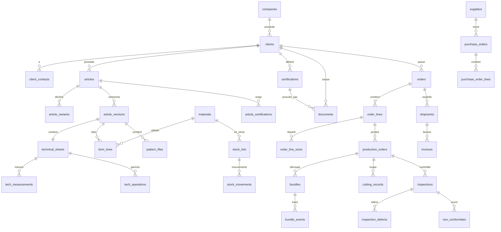

# DATABASE_SCHEMA — PostgreSQL (Supabase)

> Statut : v1 (conception). SQL de référence ; à découper en migrations `supabase/migrations/`.

## 1. Conventions
- Schéma `public` pour le métier ; `private` pour les fonctions de sécurité.
- Clé primaire : `id uuid default gen_random_uuid()`.
- Colonnes communes : `company_id uuid not null`, `created_at timestamptz default now()`, `updated_at`, `created_by uuid`, `updated_by uuid`, `deleted_at timestamptz` (archivage).
- Noms en `snake_case` (anglais pour les tables/colonnes, libellés métier en français dans l'UI).
- Montants/quantités : `numeric(15,3)`. Statuts : types `enum` ou `text` + `check`.
- Extensions : `pgcrypto`, `pg_trgm`, `vector` (pgvector), `pg_cron` **[À CONFIRMER]**.
- **RLS activée sur toutes les tables** ; aucune table exposée sans politique.
- Trigger générique `set_updated_at()` et trigger d'audit `audit_row_change()`.

## 2. Isolation par client : le modèle
- `company_id` : la société MB (multi-société possible, ici une seule en pratique).
- `client_id` : le client donneur d'ordre. **Présent sur toutes les tables liées au catalogue client** (articles, versions, documents, certifications, commandes…).
- Les données partagées (matières, fournisseurs, opérations types) n'ont que `company_id`.

## 3. Diagramme entité-relation (simplifié)



## 4. Tables

### 4.1 Noyau & sécurité
```sql
create table companies (
  id uuid primary key default gen_random_uuid(),
  name text not null, legal_id text, country char(2) default 'TN',
  base_currency char(3) default 'TND', created_at timestamptz default now()
);

create table profiles (               -- 1:1 avec auth.users
  id uuid primary key references auth.users(id) on delete cascade,
  company_id uuid not null references companies(id),
  full_name text not null, phone text, locale text default 'fr',
  user_type text not null check (user_type in ('internal','client')),
  client_id uuid references clients(id),           -- obligatoire si user_type='client'
  is_active boolean default true,
  check ((user_type='client') = (client_id is not null))
);

create table roles (
  id uuid primary key default gen_random_uuid(),
  company_id uuid not null references companies(id),
  code text not null, label text not null, unique(company_id, code)
);
create table permissions (            -- ex: 'articles.read', 'orders.confirm'
  id uuid primary key default gen_random_uuid(),
  code text unique not null, module text not null, description text
);
create table role_permissions (
  role_id uuid references roles(id) on delete cascade,
  permission_id uuid references permissions(id) on delete cascade,
  primary key (role_id, permission_id)
);
create table user_roles (
  user_id uuid references profiles(id) on delete cascade,
  role_id uuid references roles(id) on delete cascade,
  primary key (user_id, role_id)
);
-- Accès restreint d'un utilisateur interne à certains clients (optionnel)
create table user_client_access (
  user_id uuid references profiles(id) on delete cascade,
  client_id uuid references clients(id) on delete cascade,
  primary key (user_id, client_id)
);

create table audit_logs (
  id bigint generated always as identity primary key,
  company_id uuid, table_name text not null, record_id uuid,
  action text not null,                 -- insert/update/delete/status_change/login
  old_data jsonb, new_data jsonb, user_id uuid, ip inet,
  created_at timestamptz default now()
);
create table doc_sequences (
  company_id uuid, code text, year int, last_value int default 0,
  primary key (company_id, code, year)
);
create table settings (company_id uuid, key text, value jsonb, primary key(company_id, key));
```

### 4.2 Clients
```sql
create table clients (
  id uuid primary key default gen_random_uuid(),
  company_id uuid not null references companies(id),
  code text not null, name text not null, country char(2),
  vat_number text, currency char(3) default 'EUR', incoterm text,
  payment_terms text, delivery_tolerance_pct numeric(5,2) default 5,
  aql_level text, status text default 'active',
  created_at timestamptz default now(), updated_at timestamptz, deleted_at timestamptz,
  unique(company_id, code)
);
create table client_contacts (
  id uuid primary key default gen_random_uuid(),
  client_id uuid not null references clients(id),
  name text, email text, phone text, role text, is_primary boolean default false
);
create table client_addresses (
  id uuid primary key default gen_random_uuid(),
  client_id uuid not null references clients(id),
  type text check (type in ('billing','delivery')), line1 text, city text, zip text, country char(2)
);
```

### 4.3 Catalogue produit (par client)
```sql
create table size_grids (            -- grille de tailles (S..3XL, 44..60…)
  id uuid primary key default gen_random_uuid(),
  company_id uuid not null, client_id uuid references clients(id), name text, sizes text[] not null
);

create table articles (
  id uuid primary key default gen_random_uuid(),
  company_id uuid not null, client_id uuid not null references clients(id),
  code text not null,                 -- code MB
  client_ref text, name text not null, family text,   -- veste, pantalon, combinaison…
  size_grid_id uuid references size_grids(id),
  status text default 'draft' check (status in ('draft','active','archived')),
  active_version_id uuid,             -- FK ajoutée après article_versions
  created_at timestamptz default now(), updated_at timestamptz, deleted_at timestamptz,
  unique(company_id, code), unique(client_id, client_ref)
);

create table article_variants (       -- couleur × taille
  id uuid primary key default gen_random_uuid(),
  article_id uuid not null references articles(id),
  client_id uuid not null references clients(id),      -- dénormalisé pour RLS
  color_code text, color_name text, size text not null, client_sku text, barcode text,
  unique(article_id, color_code, size)
);

create table article_versions (       -- version commune FT + BOM + patronage
  id uuid primary key default gen_random_uuid(),
  article_id uuid not null references articles(id),
  client_id uuid not null references clients(id),
  version_no int not null,
  status text not null default 'draft'
    check (status in ('draft','in_review','validated','obsolete')),
  validated_by uuid references profiles(id), validated_at timestamptz,
  client_approval_doc_id uuid, client_approved_at date,
  change_note text, created_at timestamptz default now(),
  unique(article_id, version_no)
);
alter table articles add foreign key (active_version_id) references article_versions(id);

create table technical_sheets (
  id uuid primary key default gen_random_uuid(),
  version_id uuid unique not null references article_versions(id),
  client_id uuid not null references clients(id),
  description text, standards text[], marking_instructions text,
  packing_instructions text, notes text
);
create table tech_measurements (       -- tableau de mesures
  id uuid primary key default gen_random_uuid(),
  sheet_id uuid not null references technical_sheets(id), client_id uuid not null,
  point_code text, point_label text, size text, value_cm numeric(8,2),
  tol_plus numeric(5,2), tol_minus numeric(5,2)
);
create table operations (              -- opérations types (catalogue)
  id uuid primary key default gen_random_uuid(),
  company_id uuid not null, code text, label text, machine_type text, default_rate numeric(10,3)
);
create table tech_operations (         -- gamme opératoire
  id uuid primary key default gen_random_uuid(),
  sheet_id uuid not null references technical_sheets(id), client_id uuid not null,
  seq int not null, operation_id uuid references operations(id), label text,
  stage text check (stage in ('cutting','sewing','finishing','quality','packing')),
  sam_minutes numeric(8,3), piece_rate numeric(10,3)
);

create table materials (               -- catalogue matières partagé
  id uuid primary key default gen_random_uuid(),
  company_id uuid not null, code text not null, name text not null,
  type text check (type in ('fabric','lining','thread','zipper','button','label','packaging','other')),
  unit text not null default 'm', width_cm numeric(6,1), composition text, weight_gsm numeric(7,2),
  default_supplier_id uuid, avg_cost numeric(15,3) default 0, min_stock numeric(15,3) default 0,
  unique(company_id, code)
);
create table bom_lines (
  id uuid primary key default gen_random_uuid(),
  version_id uuid not null references article_versions(id), client_id uuid not null,
  material_id uuid not null references materials(id),
  position text,                       -- ex: "corps", "doublure"
  qty_per_piece numeric(15,4) not null, unit text not null,
  size text,                           -- NULL = toutes tailles
  color_code text, waste_pct numeric(5,2) default 0,
  mandatory_supplier_id uuid, client_supplied boolean default false
);
create table pattern_files (
  id uuid primary key default gen_random_uuid(),
  version_id uuid not null references article_versions(id), client_id uuid not null,
  document_id uuid not null,           -- fichier dans la GED
  format text, sizes text[], validated_at date
);
```

### 4.4 GED & certifications
```sql
create table document_types (
  id uuid primary key default gen_random_uuid(), company_id uuid, code text, label text,
  requires_expiry boolean default false
);
create table documents (
  id uuid primary key default gen_random_uuid(),
  company_id uuid not null,
  client_id uuid references clients(id),           -- NULL = document interne MB
  scope text not null default 'client' check (scope in ('client','internal')),
  type_id uuid references document_types(id),
  title text not null, version int default 1, status text default 'active'
    check (status in ('draft','active','archived')),
  storage_bucket text not null default 'ged', storage_path text not null,
  file_name text, mime_type text, size_bytes bigint, sha256 text,
  entity_type text, entity_id uuid,                -- lien polymorphe (article, order, inspection…)
  valid_from date, valid_until date,
  tags text[], uploaded_by uuid, created_at timestamptz default now(), deleted_at timestamptz,
  check ((scope='client') = (client_id is not null))
);
create table document_chunks (          -- recherche IA (pgvector)
  id uuid primary key default gen_random_uuid(),
  document_id uuid not null references documents(id) on delete cascade,
  client_id uuid references clients(id),           -- copié pour la RLS
  content text, embedding vector(1536)
);

create table certification_types (      -- ISO 20471, EN 11612, OEKO-TEX…
  id uuid primary key default gen_random_uuid(), company_id uuid, code text, label text
);
create table certifications (
  id uuid primary key default gen_random_uuid(),
  company_id uuid not null, client_id uuid references clients(id),
  type_id uuid references certification_types(id),
  certificate_no text, issuer text, issued_on date, expires_on date not null,
  status text default 'valid' check (status in ('valid','expiring','expired','revoked')),
  document_id uuid references documents(id), scope_note text
);
create table article_certifications (   -- certifs exigées par article
  article_id uuid references articles(id), certification_type_id uuid references certification_types(id),
  client_id uuid not null, mandatory boolean default true,
  primary key (article_id, certification_type_id)
);
create table material_certifications (
  material_id uuid references materials(id), certification_id uuid references certifications(id),
  primary key (material_id, certification_id)
);
```

### 4.5 Commandes
```sql
create table orders (
  id uuid primary key default gen_random_uuid(),
  company_id uuid not null, client_id uuid not null references clients(id),
  order_no text not null, client_po text,
  status text default 'draft' check (status in
    ('draft','confirmed','in_production','completed','shipped','invoiced','cancelled')),
  order_date date, delivery_date date, incoterm text, currency char(3),
  confirmed_by uuid, confirmed_at timestamptz, notes text,
  created_at timestamptz default now(), updated_at timestamptz, deleted_at timestamptz,
  unique(company_id, order_no)
);
create table order_lines (
  id uuid primary key default gen_random_uuid(),
  order_id uuid not null references orders(id), client_id uuid not null,
  article_id uuid not null references articles(id), version_id uuid references article_versions(id),
  unit_price numeric(15,3), total_qty numeric(15,3)
);
create table order_line_sizes (
  id uuid primary key default gen_random_uuid(),
  order_line_id uuid not null references order_lines(id), client_id uuid not null,
  variant_id uuid not null references article_variants(id), qty numeric(15,3) not null check (qty>0)
);
create table order_amendments (
  id uuid primary key default gen_random_uuid(), order_id uuid references orders(id),
  client_id uuid, reason text, changes jsonb, created_by uuid, created_at timestamptz default now()
);
```
Contrainte appliquée par trigger : `order_lines.article_id` appartient au même `client_id` que `orders` (BR-CLI-002).

### 4.6 Achats & stock
```sql
create table suppliers (
  id uuid primary key default gen_random_uuid(), company_id uuid not null,
  code text, name text, country char(2), email text, phone text, lead_time_days int
);
create table purchase_orders (
  id uuid primary key default gen_random_uuid(), company_id uuid not null,
  supplier_id uuid references suppliers(id), po_no text unique, status text default 'draft'
    check (status in ('draft','sent','partial','received','cancelled')),
  expected_date date, currency char(3)
);
create table purchase_order_lines (
  id uuid primary key default gen_random_uuid(), po_id uuid references purchase_orders(id),
  material_id uuid references materials(id), qty numeric(15,3), unit_price numeric(15,3), received_qty numeric(15,3) default 0
);
create table warehouses (id uuid primary key default gen_random_uuid(), company_id uuid, name text);
create table stock_lots (
  id uuid primary key default gen_random_uuid(), company_id uuid not null,
  material_id uuid not null references materials(id), warehouse_id uuid references warehouses(id),
  lot_code text, shade text, width_cm numeric(6,1),
  ownership text not null default 'mb' check (ownership in ('mb','client')),
  owner_client_id uuid references clients(id),        -- si ownership='client'
  supplier_id uuid references suppliers(id), po_line_id uuid, unit_cost numeric(15,3),
  check ((ownership='client') = (owner_client_id is not null))
);
create table stock_movements (          -- immuable : insert uniquement
  id bigint generated always as identity primary key,
  company_id uuid not null, lot_id uuid not null references stock_lots(id),
  type text not null check (type in ('receipt','issue','transfer','return','adjustment')),
  qty numeric(15,3) not null,           -- signé (+ entrée, − sortie)
  reason text, ref_type text, ref_id uuid, production_order_id uuid,
  created_by uuid, created_at timestamptz default now()
);
create table stock_reservations (
  id uuid primary key default gen_random_uuid(), production_order_id uuid,
  material_id uuid, lot_id uuid, qty numeric(15,3), status text default 'active'
);
create view v_stock_levels as
  select lot_id, sum(qty) as qty_on_hand from stock_movements group by lot_id;
```

### 4.7 Production
```sql
create table production_orders (
  id uuid primary key default gen_random_uuid(), company_id uuid not null,
  client_id uuid not null references clients(id), of_no text unique not null,
  order_line_id uuid not null references order_lines(id),
  version_id uuid not null references article_versions(id),   -- version figée
  status text default 'planned' check (status in
    ('planned','confirmed','cutting','sewing','finishing','quality','packing','done','cancelled')),
  planned_start date, planned_end date, workshop_id uuid
);
create table production_stage_templates (
  id uuid primary key default gen_random_uuid(), company_id uuid, family text,
  seq int, stage text, label text
);
create table workshops (id uuid primary key default gen_random_uuid(), company_id uuid, name text, type text);
create table cutting_records (
  id uuid primary key default gen_random_uuid(), production_order_id uuid not null references production_orders(id),
  client_id uuid not null, lot_id uuid references stock_lots(id),
  layers int, marker_length_m numeric(8,3), fabric_used_m numeric(12,3), standard_m numeric(12,3), cut_at timestamptz
);
create table bundles (
  id uuid primary key default gen_random_uuid(), production_order_id uuid not null references production_orders(id),
  client_id uuid not null, barcode text unique not null, variant_id uuid references article_variants(id),
  qty numeric(10,0) not null, current_stage text, status text default 'open'
);
create table bundle_events (
  id bigint generated always as identity primary key, bundle_id uuid not null references bundles(id),
  client_id uuid not null, stage text, operation_id uuid, employee_id uuid,
  qty_good numeric(10,0), qty_rejected numeric(10,0) default 0, minutes_spent numeric(8,2),
  created_by uuid, created_at timestamptz default now()
);
create table subcontract_orders (
  id uuid primary key default gen_random_uuid(), production_order_id uuid, supplier_id uuid,
  service text, qty_sent numeric, qty_returned numeric, sent_on date, returned_on date
);
```

### 4.8 Qualité
```sql
create table inspections (
  id uuid primary key default gen_random_uuid(), company_id uuid not null, client_id uuid not null,
  type text check (type in ('incoming','inline','final')), production_order_id uuid, material_lot_id uuid,
  aql_plan text, sample_size int, accepted boolean, inspector_id uuid, inspected_at timestamptz
);
create table defect_types (id uuid primary key default gen_random_uuid(), company_id uuid, code text, label text);
create table inspection_defects (
  id uuid primary key default gen_random_uuid(), inspection_id uuid references inspections(id), client_id uuid not null,
  defect_type_id uuid references defect_types(id), severity text check (severity in ('minor','major','critical')),
  qty int, origin_operation_id uuid, origin_employee_id uuid,
  disposition text check (disposition in ('rework','downgrade','scrap'))
);
create table non_conformities (
  id uuid primary key default gen_random_uuid(), company_id uuid not null, client_id uuid,
  nc_no text unique, source text check (source in ('internal','client','supplier')),
  description text, root_cause text, corrective_action text, owner_id uuid,
  due_date date, status text default 'open' check (status in ('open','in_progress','closed'))
);
```

### 4.9 Expéditions, facturation, coûts
```sql
create table shipments (
  id uuid primary key default gen_random_uuid(), company_id uuid not null, client_id uuid not null,
  shipment_no text unique, order_id uuid references orders(id), shipped_on date, carrier text,
  tracking_no text, status text default 'draft' check (status in ('draft','packed','shipped','delivered'))
);
create table shipment_lines (
  id uuid primary key default gen_random_uuid(), shipment_id uuid references shipments(id), client_id uuid not null,
  order_line_id uuid references order_lines(id), variant_id uuid, qty numeric(15,3), carton_no text
);
create table invoices (
  id uuid primary key default gen_random_uuid(), company_id uuid not null, client_id uuid not null,
  invoice_no text unique, shipment_id uuid, issued_on date, due_on date, currency char(3),
  exchange_rate numeric(12,6), total_ht numeric(15,3), total_vat numeric(15,3), total_ttc numeric(15,3),
  status text default 'draft' check (status in ('draft','issued','paid','cancelled'))
);
create table invoice_lines (id uuid primary key default gen_random_uuid(), invoice_id uuid references invoices(id), description text, qty numeric, unit_price numeric, vat_rate numeric);
create table cost_sheets (
  id uuid primary key default gen_random_uuid(), client_id uuid not null, version_id uuid references article_versions(id),
  material_cost numeric(15,3), labour_cost numeric(15,3), subcontract_cost numeric(15,3),
  overhead_cost numeric(15,3), packing_cost numeric(15,3), total_cost numeric(15,3), computed_at timestamptz
);
```

### 4.10 RH (rendement)
```sql
create table employees (
  id uuid primary key default gen_random_uuid(), company_id uuid not null, profile_id uuid references profiles(id),
  matricule text unique, full_name text, workshop_id uuid, position text, hired_on date, status text default 'active'
);
create table attendance (id uuid primary key default gen_random_uuid(), employee_id uuid references employees(id), day date, hours numeric(5,2), overtime numeric(5,2), absence_type text);
```
Les demandes RH (congés, retards, sorties, attestations) peuvent reprendre le modèle de WorkVoice **[À CONFIRMER]**.

## 5. Row Level Security

Fonctions helpers (schéma `private`, `security definer`, `stable`) :
```sql
create function private.current_company() returns uuid language sql stable security definer as
$$ select company_id from public.profiles where id = auth.uid() $$;

create function private.is_client_user() returns boolean language sql stable security definer as
$$ select user_type = 'client' from public.profiles where id = auth.uid() $$;

create function private.has_perm(p text) returns boolean language sql stable security definer as
$$ select exists (
  select 1 from user_roles ur join role_permissions rp using(role_id)
  join permissions pe on pe.id = rp.permission_id
  where ur.user_id = auth.uid() and pe.code = p) $$;

create function private.can_see_client(c uuid) returns boolean language sql stable security definer as
$$ select case
  when (select user_type from profiles where id = auth.uid()) = 'client'
    then c = (select client_id from profiles where id = auth.uid())
  else exists (select 1 from clients where id = c and company_id = private.current_company())
       and (not exists (select 1 from user_client_access where user_id = auth.uid())
            or exists (select 1 from user_client_access where user_id = auth.uid() and client_id = c))
  end $$;
```
Modèle de politique (appliqué à toute table avec `client_id`) :
```sql
alter table articles enable row level security;
create policy articles_select on articles for select
  using (private.can_see_client(client_id) and private.has_perm('articles.read'));
create policy articles_write on articles for all
  using (not private.is_client_user() and private.can_see_client(client_id) and private.has_perm('articles.write'))
  with check (not private.is_client_user() and private.can_see_client(client_id) and private.has_perm('articles.write'));
```
Règles :
- Les utilisateurs **client** n'ont accès qu'en lecture, et seulement aux tables autorisées (commandes, documents `active`, expéditions, avancement).
- `stock_movements`, `audit_logs` : insertion via fonctions uniquement ; pas d'UPDATE/DELETE.
- Tables sans `client_id` : filtrées par `company_id` + permission.

### Storage
- Buckets privés : `ged`, `patterns`, `certificates`.
- Politique `storage.objects` : accès si `(storage.foldername(name))[1]` = un `client_id` visible par `private.can_see_client(...)` (cf. BR-GED-003) ; écriture selon permission `ged.write`.
- Téléchargement par URL signée (≤ 5 min).

## 6. Fonctions métier (RPC transactionnelles)
`next_doc_no(code)`, `confirm_order(order_id)`, `create_production_order(order_line_id)`, `reserve_materials(of_id)`, `issue_material(of_id, lot_id, qty)`, `advance_bundle(bundle_id, stage, good, rejected)`, `validate_article_version(version_id)`, `create_new_version(article_id)`, `release_shipment(shipment_id)` (contrôle BR-CER-003), `refresh_certification_status()` (cron quotidien).

## 7. Index & performance
- Index sur toutes les FK, `(client_id, status)`, `(company_id, order_no)`, `bundles.barcode`, `documents(client_id, type_id)`, `certifications(expires_on)`.
- `pg_trgm` sur noms d'articles/clients ; index `ivfflat/hnsw` sur `document_chunks.embedding`.
- Vues matérialisées pour tableaux de bord (avancement commandes, WIP par étape, stock par matière).

## 8. Migrations prévues
`0001_extensions` · `0002_core_security` · `0003_clients` · `0004_catalog` · `0005_ged_certifications` · `0006_orders` · `0007_stock_purchasing` · `0008_production` · `0009_quality` · `0010_shipping_invoicing_costs` · `0011_hr` · `0012_rls_policies` · `0013_functions_triggers` · `0014_storage_policies` · `0015_ai_vectors`.
