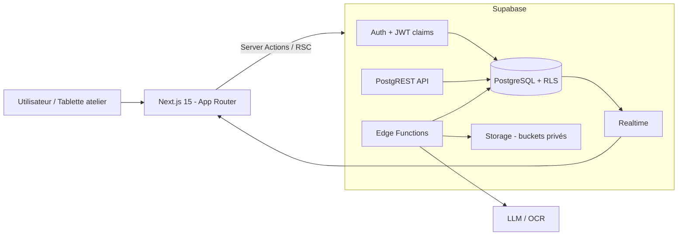
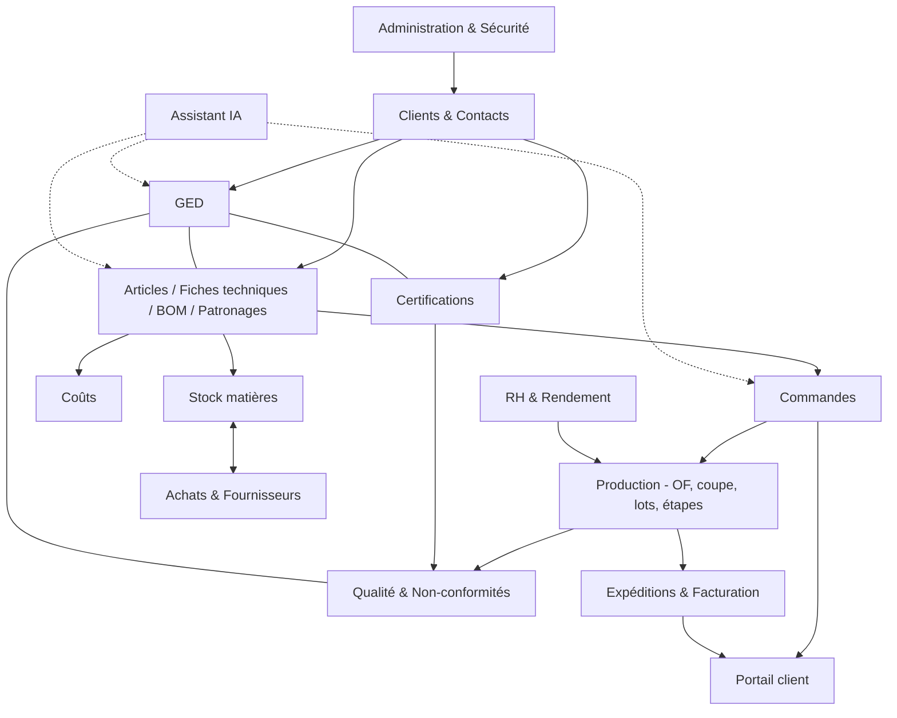

# PROJECT_VISION — WORKMAN ERP 360

> Statut : v1 (architecture). Les points **[À CONFIRMER]** sont des hypothèses à valider avec la direction.

## 1. Vision
MB Confection fabrique des **vêtements professionnels** (workwear) pour des clients **européens**. Chaque client impose son propre univers : articles, nomenclatures (BOM), fiches techniques, patronages, certifications et documents. L'ERP doit gérer cette réalité **client par client**, de la commande à l'expédition, avec un assistant IA qui réduit le travail administratif et les erreurs.

> « Un seul système où chaque client a son dossier produit complet, traçable et exploitable en atelier. »

## 2. Problèmes à résoudre
- Fiches techniques, patronages et certificats dispersés (mails, disques, papier).
- Nomenclatures et versions d'articles différentes selon le client, risque de confusion en production.
- Exigences de conformité européenne (certifications, traçabilité) difficiles à prouver en audit.
- Suivi atelier (coupe, couture, finition, contrôle, emballage) peu visible en temps réel.
- Stock matières (tissus, fournitures) et coûts mal maîtrisés.

## 3. Objectifs
1. **Isolation par client** : articles, BOM, fiches techniques, patronages, certifications, GED rattachés à un client.
2. **GED intégrée** : documents versionnés, typés, avec dates de validité et alertes d'expiration.
3. **Production tracée** : OF → lots/colis → étapes → contrôle qualité, avec lien vers la version exacte de la fiche technique/BOM utilisée.
4. **Stock & achats** : besoins matières calculés depuis les BOM, réservations, réceptions, mouvements immuables.
5. **Qualité & conformité** : inspections AQL, défauts, non-conformités, certificats attachés aux clients/articles.
6. **Coûts & marges** : coût de revient par article/commande.
7. **IA** : recherche en langage naturel dans la GED, extraction automatique de données depuis les PDF (commandes, certificats), aide à la saisie des BOM, détection d'anomalies, résumés de commande. **[À CONFIRMER]** fournisseur du modèle.
8. **Portail client** (phase ultérieure) : consultation commandes, documents et avancement.

## 4. Hors périmètre (v1)
- Comptabilité générale complète (export vers l'expert-comptable).
- Planification à capacité finie (APS).
- Boutique en ligne.

## 5. Utilisateurs
Direction, Administrateur, Commercial/Export, Bureau des méthodes, Responsable production, Chef d'atelier, Magasinier, Qualité, RH, Comptable, Client (portail). Voir `USER_ROLES.md`.

## 6. Stack technique

| Couche | Choix |
|---|---|
| Frontend | Next.js 15 (App Router), TypeScript, Tailwind CSS, shadcn/ui |
| Backend | Supabase (Auth, PostgREST, Edge Functions, Realtime) |
| Base de données | PostgreSQL (Supabase) + Row Level Security |
| Stockage | Supabase Storage (buckets privés, URLs signées) |
| IA | Edge Functions appelant un LLM + `pgvector` pour la recherche sémantique **[À CONFIRMER]** |
| Hébergement | Vercel (front) + Supabase Cloud/UE **[À CONFIRMER]** |

## 7. Architecture technique



Principes :
- **RLS partout** : la sécurité est dans PostgreSQL, pas seulement dans l'UI.
- **Clients Supabase** : navigateur (clé anon + session utilisateur) et serveur (SSR). La clé `service_role` n'est utilisée que dans les Edge Functions / jobs, jamais côté navigateur.
- **Logique métier critique** (confirmation de commande, mouvements de stock, avancement d'étape) dans des **fonctions SQL / RPC transactionnelles**.
- **Types** générés depuis le schéma (`supabase gen types typescript`).
- **Migrations** versionnées dans `supabase/migrations`.

## 8. Structure de dossiers

```
MB-CONFECTION-ERP/
├── docs/
│   ├── PROJECT_VISION.md
│   ├── BUSINESS_RULES.md
│   ├── DATABASE_SCHEMA.md
│   ├── USER_ROLES.md
│   └── ROADMAP.md
├── supabase/
│   ├── config.toml
│   ├── migrations/            # 0001_extensions.sql, 0002_core.sql, ...
│   ├── seed.sql
│   ├── functions/             # Edge Functions (ia-search, extract-document, expiry-alerts)
│   └── tests/                 # tests pgTAP (RLS, règles métier)
├── web/                       # Next.js 15
│   ├── src/
│   │   ├── app/
│   │   │   ├── (auth)/login/
│   │   │   ├── (erp)/
│   │   │   │   ├── dashboard/
│   │   │   │   ├── clients/[clientId]/{articles,documents,certifications,commandes}/
│   │   │   │   ├── articles/[id]/{fiche-technique,nomenclature,patronages}/
│   │   │   │   ├── commandes/
│   │   │   │   ├── production/{ordres,suivi,coupe}/
│   │   │   │   ├── stock/{matieres,mouvements,inventaires}/
│   │   │   │   ├── achats/
│   │   │   │   ├── qualite/
│   │   │   │   ├── ged/
│   │   │   │   ├── expeditions/
│   │   │   │   ├── couts/
│   │   │   │   ├── rh/
│   │   │   │   ├── ia/
│   │   │   │   └── admin/{utilisateurs,roles,parametres,audit}/
│   │   │   └── (portail-client)/
│   │   ├── components/{ui,layout,forms,tables,ged}/
│   │   ├── features/<module>/{actions,queries,schemas,components}/
│   │   ├── lib/{supabase/{client,server,middleware}.ts,auth,permissions,utils}/
│   │   ├── types/database.types.ts   # généré
│   │   └── middleware.ts
│   ├── components.json        # shadcn
│   ├── tailwind.config.ts
│   └── package.json
├── .env.example
└── README.md
```

## 9. Diagramme des modules



## 10. Indicateurs de succès
- 100 % des articles actifs avec fiche technique + BOM + patronage validés.
- 0 certificat expiré non signalé.
- Taux de livraison à l'heure > 95 %.
- Écart stock théorique/réel < 2 %.
- Temps de recherche d'un document < 10 s.
