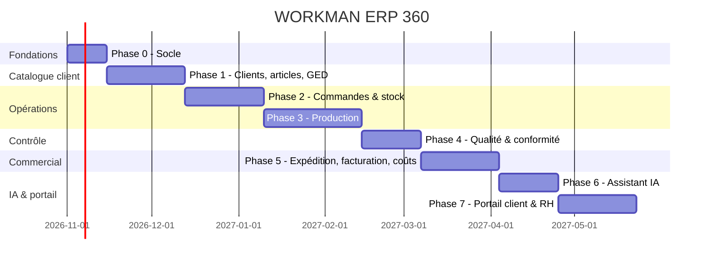

# ROADMAP — Plan de développement

> Statut : v1. Durées indicatives pour une petite équipe (2–3 développeurs) **[À CONFIRMER]**. Chaque phase se termine par une démo + validation métier.

## Vue d'ensemble

## Phase 0 — Socle (≈ 2 semaines)
- Dépôt, environnements (local Supabase CLI, staging, prod), CI (lint, types, tests).
- Next.js 15 + TypeScript + Tailwind + shadcn/ui, layout, navigation, thème, i18n (FR).
- Supabase : migrations `0001–0002`, Auth, profils, rôles/permissions, RLS de base, audit, numérotation.
- Génération des types, clients Supabase SSR/navigateur, middleware de session.
- **Sortie** : connexion, rôles, menu filtré par permission, premier test RLS.

## Phase 1 — Clients, catalogue produit, GED (≈ 4 semaines)
- Clients, contacts, adresses, grilles de tailles.
- Articles + variantes (couleur × taille).
- Versions d'article : fiche technique, mesures, gamme opératoire, BOM, patronages ; workflow brouillon → validée.
- GED : upload vers Storage (buckets privés, chemin normalisé), types de documents, versioning, URL signées, hash.
- Certifications : types, enregistrement, alertes d'expiration (cron).
- **Sortie** : un client complet (articles + BOM + FT + patronage + certificats) créé, cloisonné ; test d'isolation inter-clients réussi.

## Phase 2 — Commandes, achats, stock (≈ 4 semaines)
- Commandes avec matrice taille/couleur, confirmation (contrôles BR-ART-010, BR-CER-003), avenants.
- Matières, fournisseurs, commandes fournisseurs, réceptions.
- Stock par lot/rouleau, mouvements immuables, réservations, inventaires, alertes de seuil.
- Calcul des besoins matières depuis la BOM.
- **Sortie** : commande confirmée → besoins calculés → matière réceptionnée et réservée.

## Phase 3 — Production (≈ 5 semaines)
- Ordres de fabrication (version figée), plan d'étapes par famille.
- Coupe (consommation vs standard), lots/paquets avec code-barres, événements d'étape.
- Interface tablette atelier (scan, saisie rapide, gros boutons), Realtime pour le suivi.
- Sous-traitance (envoi/retour), rendement par opérateur (SAM).
- **Sortie** : une commande réelle suivie de la coupe à l'emballage.

## Phase 4 — Qualité & conformité (≈ 3 semaines)
- Inspections (réception, en cours, final AQL), défauts, retouches.
- Non-conformités et actions correctives, preuves GED.
- Blocage de lots, traçabilité colis → OF → rouleau → certificat.
- **Sortie** : audit de traçabilité simulé réussi sur un colis.

## Phase 5 — Expédition, facturation, coûts (≈ 4 semaines)
- Expéditions, colisage, packing list, blocage si certification expirée.
- Factures, avoirs, paiements, devises/taux.
- Coûts de revient standard vs réel, marges, tableaux de bord Direction.
- **Sortie** : cycle complet commande → facture sur un client pilote.

## Phase 6 — Assistant IA (≈ 3 semaines)
- Ingestion GED : extraction de texte/OCR, découpage, embeddings `pgvector`.
- Recherche en langage naturel respectant la RLS (par client).
- Extraction assistée (commande PDF, certificat, BOM) avec validation humaine.
- Alertes intelligentes : écarts de consommation, retards probables, certificats à renouveler.
- Journal des appels IA, garde-fous (BR-IA-001 à 004).
- **Sortie** : recherche documentaire fiable + extraction validée sur jeux de documents réels.

## Phase 7 — Portail client & RH (≈ 4 semaines)
- Portail client (lecture seule) : commandes, avancement, documents partagés, certificats.
- Module RH/présence/rendement ; reprise éventuelle des demandes WorkVoice.
- Notifications e-mail (expiration, expéditions).
- **Sortie** : un client pilote se connecte et suit ses commandes.

## Transversal à chaque phase
- Tests pgTAP (RLS + règles métier avec IDs `BR-*`), tests e2e Playwright des parcours clés.
- Mise à jour des 5 documents `docs/` dans la même PR que le changement.
- Import des données existantes (Excel) avec contrôles et rapport d'erreurs.
- Formation utilisateurs, recette (UAT), sauvegardes et test de restauration.
- Revue sécurité avant chaque mise en production.

## Jalons
| Jalon | Contenu | Cible |
|---|---|---|
| M1 | Socle + catalogue client + GED | fin Phase 1 |
| M2 | Commande → stock opérationnels | fin Phase 2 |
| **M3 (MVP)** | Production atelier en réel sur un client pilote | fin Phase 3 |
| M4 | Qualité & traçabilité complètes | fin Phase 4 |
| M5 | Cycle commande → facture | fin Phase 5 |
| M6 | IA + portail client | fin Phase 7 |

## Risques & parades
| Risque | Parade |
|---|---|
| Règles métier floues ou changeantes | Valider `BUSINESS_RULES.md` avec la production avant chaque phase |
| Fuite de données entre clients | RLS systématique + tests automatiques inter-clients à chaque migration |
| Adoption atelier faible | Impliquer chefs d'atelier dès la Phase 3, écrans simples tablette |
| Mauvaise qualité des données migrées | Budget de nettoyage, import par lots, rapport de contrôle |
| Dépendance au fournisseur IA / confidentialité | Validation humaine, isolation par client, contrat sans entraînement sur données **[À CONFIRMER]** |
| Complexité des BOM par taille | Prototype tôt avec 2–3 articles réels de clients différents |

## Questions ouvertes (à trancher avant la Phase 1)
1. Liste exacte des certifications et normes par client.
2. Les clients ont-ils chacun leurs règles AQL / formats de fiche technique ?
3. Faut-il intégrer les modules RH WorkVoice ou rester séparé ?
4. Hébergement : région Supabase UE ? exigences RGPD des clients européens ?
5. Fournisseur IA et politique de confidentialité acceptée par les clients.
6. Formats de patronage utilisés (DXF/PLT/Gerber/Lectra) et besoin de prévisualisation.
