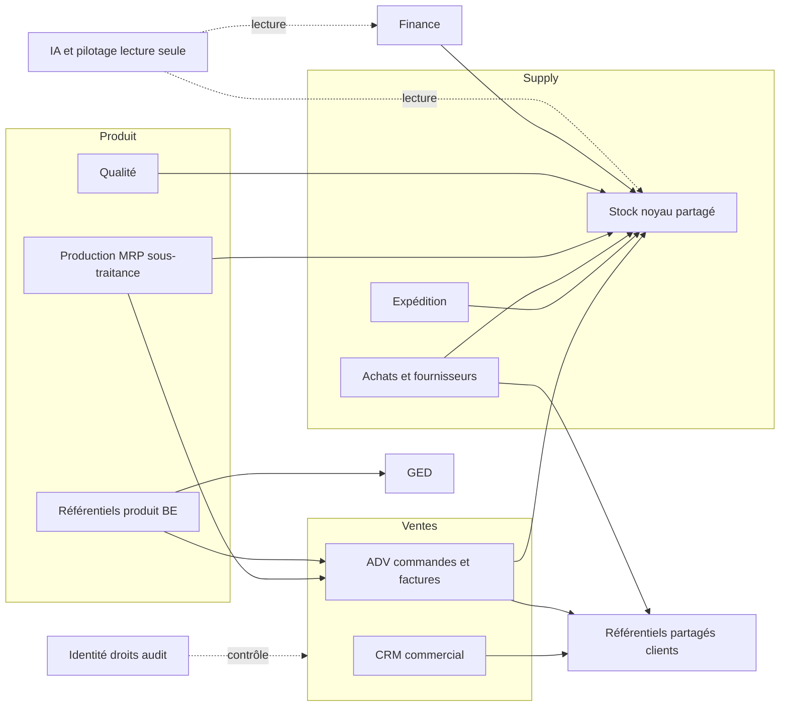
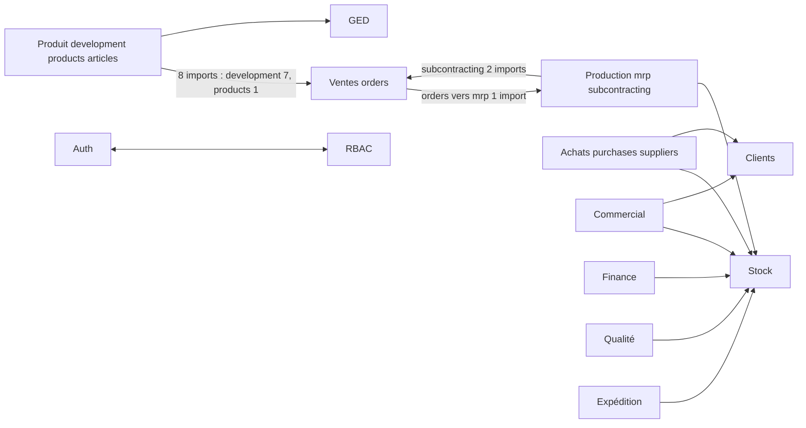
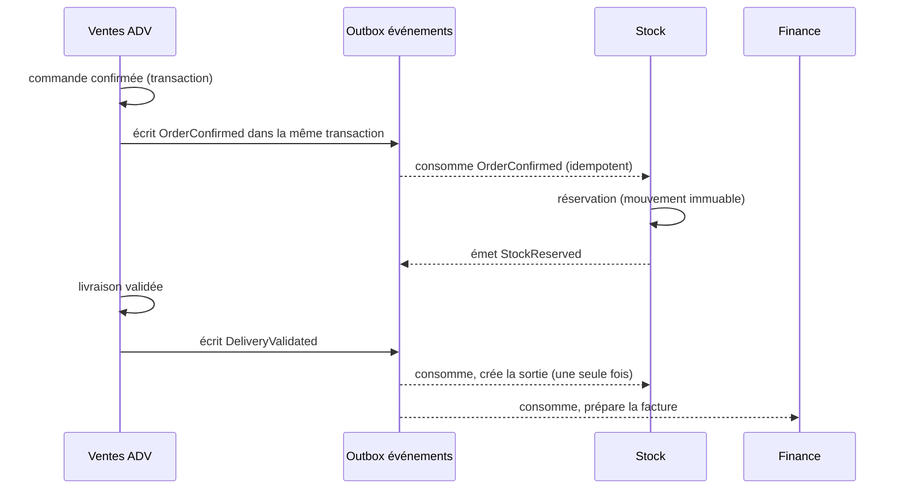

# Architecture et contrats de domaines — Lot P004 (WORKMAN ERP 360)

Date : 12 octobre 2026. Nature : **cadrage d'architecture**. Aucun code métier modifié, aucune table créée, aucune donnée touchée. Les propositions marquées « proposé » ne sont pas implémentées.

Références : `docs/ADR-001-architecture-fullweb.md` (ADR-001 : API Laravel, Next.js, Supabase, RLS), `docs/erp360/inventaire/INVENTAIRE_P001.md`, `docs/erp360/backlog/` (P003), CDC §2 (architecture) et §10 (données et intégrations).

## 1. Constats mesurés

| Constat | Mesure | Source |
|---|---|---|
| Modules web | 27 dossiers `web/src/features/*` | `scripts/check-domain-deps.mjs` |
| Dépendances entre modules | 70 arêtes ; 1 cycle connu (`auth` ↔ `rbac`) | même script |
| Noyau partagé | `stock` est importé par 8 modules métiers ; `clients` par 3 ; `ged` par 5 | graphe mesuré |
| Dépendances entre domaines à inverser | `development → orders` (7 imports), `products → orders` (1), `subcontracting → orders` (2) : la conception produit dépend des commandes | graphe mesuré |
| Propriété des tables | **125 tables, 125 attribuées à un seul domaine** (aucune orpheline, aucune en double) | `ownership.json`, vérifié contre la base locale |
| API | 1 domaine exposé (clients, 18 routes) ; les 26 autres modules passent par les services Next.js et les accès directs | INVENTAIRE_P001 |
| Accès direct à la base depuis le web | 544 `.from(` et 171 `.rpc(` | INVENTAIRE_P001 |
| Événements | aucun bus, aucune table d'événements, aucune file | recherche dans le dépôt |
| BI et IA | modules `executive`, `strategy`, `command-center`, `copilot` : ils lisent les tables de production ; aucun entrepôt BI séparé (non vérifié module par module) | INVENTAIRE_P001, matrice BI-01 |

Le cycle `auth` ↔ `rbac` est réel : `web/src/features/auth/guards.ts` appelle le journal d'accès de `rbac` (`audit-write.service`), et `rbac/actions.ts` et `rbac/services/audit-write.service.ts` appellent le contexte et le service d'audit d'`auth`. Il est enregistré comme **cycle connu (décision D-P004-01)** : son traitement modifie le code d'authentification et des droits, il n'est donc pas fait dans ce lot.

## 2. Frontières de domaines

| Domaine | Modules web | Tables (propriétaire en écriture) | Rôle |
|---|---|---|---|
| **CRM** | `commercial` (prospects, devis) | `prospects`, `prospect_activities`, `quotes`, `quote_lines` | prospection, opportunités, devis |
| **Ventes / ADV** | `orders`, `commercial` (factures, avoirs) | `sales_orders`, `sales_order_lines`, `invoices`, `invoice_lines`, `invoice_payments`, `credit_notes`, `credit_note_lines` | commande, facturation, avoirs |
| **Stock** (noyau partagé) | `stock`, `warehouses` | 18 tables (entrepôts, emplacements, lots, mouvements, réservations, inventaires, `sites`, `variant_stock`) | mouvements et soldes ; source de vérité du stock |
| **Achats et fournisseurs** | `purchases`, `suppliers` | `purchase_*` (8), `suppliers`, `supplier_*` (5) | approvisionnement, réception, dettes fournisseurs |
| **Référentiels produit (BE)** | `products`, `variants`, `articles`, `bom`, `development` | `product_*`, `articles`, `article_*`, `colors`, `sizes`, `boms`, `bom_*`, `development_*`, `prototypes`, `samples`, `industrialization`, `customer_validations` | conception, nomenclatures, gammes |
| **Production** | `production`, `mrp`, `subcontracting` | `production_orders`, `production_logs`, `work_centers`, `mrp_*` (7), `subcontract*` (5) | OF, planification, sous-traitance |
| **Qualité** | `quality` | `quality_*` (6) | contrôles, non-conformités, actions correctives |
| **SAV** | (module à créer ; réclamations existantes dans `clients`) | `client_complaints` | réclamations |
| **Expédition** | `shipping` | `shipments`, `shipment_lines`, `shipment_events` | préparation, colisage, expédition |
| **Finance** | `finance` | `gl_*` (5), `vat_rates`, `exchange_rates`, `currencies`, `cash_*`, `finance_*` | grand livre, TVA, trésorerie |
| **Référentiels partagés** | `clients` | `clients`, `client_contacts`, `client_addresses`, `payment_terms`, `companies`, `company_sequences` | fiche client et maîtres communs |
| **GED** | `ged` | `ged_*` (4) | documents |
| **Identité, droits, audit** | `auth`, `rbac`, `admin` | `profiles`, `roles`, `permissions`, `role_permissions`, `user_roles`, `audit_logs`, `auth_events` | accès et traçabilité |
| **IA et pilotage** | `copilot`, `strategy`, `command-center`, `executive`, `dashboard` | `copilot_*` (2) ; lecture seule ailleurs (proposé, ADR-005) | copilote, tableaux de bord |
| **Terrain** | `field` | aucune (utilise les domaines Production, Qualité, Stock) | interface atelier |
| **RH, POS** | absents | absents | cibles V2 (CDC §3.11, §5) |

Le détail table par table est dans `ownership.json` (125 entrées, vérifiées).

## 3. Diagrammes

### 3.1 Carte des domaines (cible)

Les flèches pleines sont des dépendances de service ; les pointillées sont des lectures seules.

### 3.2 Dépendances mesurées (agrégées par domaine, état actuel)

Lecture : `development → orders` et `products → orders` sont des **dépendances à inverser** (la conception ne doit pas appeler la vente). Au niveau des **domaines**, `Ventes ↔ Production` forme un cycle (`orders → mrp` et `subcontracting → orders`), alors qu'au niveau des **modules** il n'y en a pas : le garde-fou ne le voit donc pas. Ce cycle de domaine est à traiter dans les décisions de frontières (ADR-002). Le module de pilotage (`copilot`, `strategy`, `command-center`, `executive`) n'a de dépendances qu'entre ses propres modules et n'apparaît donc pas dans ce graphe agrégé. Le cycle `AUTH ↔ RBAC` est le cycle de module connu (D-P004-01).

### 3.3 Flux cible commande → stock → facture (proposé, ADR-004)

## 4. Décisions d'architecture

| ID | Décision | Justification | Compatibilité |
|---|---|---|---|
| **ADR-002** | Un domaine = une source de vérité en écriture (ownership.json). Les autres domaines lisent via le service du propriétaire. | 125 tables toutes attribuées ; évite les écritures croisées décrites au CDC §2.1 | aucune table déplacée ; les contrats existants restent |
| **ADR-003** | Contrats : chaque domaine expose ses services (fonctions TypeScript côté web, puis routes `/api/v1/<domaine>` côté API quand il migre). Les versions coexistent : `/v1` ne change pas de forme ; un changement incompatible crée `/v2`. | ADR-001 ; le cahier demande OpenAPI et idempotence (API-01) | les server actions et `clients` `/v1` restent en place |
| **ADR-004** | Événements métier par **outbox** dans la même transaction que l'écriture, consommateurs idempotents. Non implémenté : table à créer (additive) quand le premier flux l'exige (commande → stock). | API-02 (P1) ; évite les écritures doubles décrites au CDC MIG-05 | aucun événement existant à migrer |
| **ADR-005** | BI et IA lisent des **modèles dérivés** (schéma `bi` ou entrepôt séparé, lecture seule), jamais les tables de production en écriture ; l'IA n'agit que par des outils bornés passant par les services (API-03, IA-05). | BI-01 (P0), IA-03, NFR-06, CDC §6.1 | les tableaux actuels continuent de lire la production jusqu'à la bascule ; la bascule est une étape de migration à planifier |
| **ADR-006** | Pile : Next.js 15 (web), Laravel 12 API seule, Supabase (Auth, PostgreSQL, RLS, Storage), PostgreSQL 15. **Redis et MinIO : non adoptés à ce stade** (aucune mesure de besoin ; NFR-02 non mesuré). | ADR-001 ; ARC-B ; pas de réécriture | Redis et MinIO sont des options ouvertes, à décider avec les mesures de charge |
| **D-P004-01** | Cycle `auth` ↔ `rbac` : extraire le journal d'audit dans un module partagé neutre. | cycle mesuré | à décider ; non fait ici |

Aucune de ces décisions ne réécrit un module existant. Chacune est une **évolution progressive**, à activer quand son lot (P0/P1 du backlog) est lancé.

## 5. Coexistence et migration (sans refonte implicite)

1. **Pas de déplacement de tables** : la propriété est déclarée, pas transférée.
2. **Pas de suppression de service** : les services et server actions actuels restent appelables pendant toute la transition (MIG-02).
3. **Nouvelles routes API par domaine**, ajoutées une à une. La première cible est **Stock** (noyau partagé utilisé par 8 modules), puis **Ventes**.
4. **Activation par drapeau** d'environnement pour chaque bascule ; retour arrière = désactiver le drapeau (MIG-06).
5. **Garde-fou** : `scripts/check-domain-deps.mjs` refuse toute nouvelle dépendance entre modules, tout nouveau module non déclaré et tout nouveau cycle. Il est lancé avant chaque lot.

## 6. Contrôles exécutés

| Contrôle | Résultat |
|---|---|
| Propriété des tables : toutes les tables de `public` (125) comparées à `ownership.json` | **125/125 attribuées, 0 orpheline, 0 en double** |
| `node scripts/check-domain-deps.mjs --record` puis contrôle | référence enregistrée : 27 modules, 70 arêtes, 1 cycle connu |
| `node scripts/check-domain-deps.mjs` (état actuel) | **conforme** : 0 arête nouvelle, 0 cycle nouveau, 0 module nouveau |
| Test négatif : copie de `features/` avec deux imports ajoutés (`crm → finance`, `finance → crm`) | **détecté** : 2 arêtes nouvelles, 1 cycle nouveau, 1 module nouveau, code de sortie 1 |
| `node scripts/check-domain-deps.mjs --mermaid` | graphe Mermaid produit (sortie vérifiée) |

Le test négatif a été exécuté sur une copie dans le dossier de travail, jamais sur le code source.

## 7. Limites

- La mesure porte sur les **imports TypeScript**. Les dépendances **au niveau SQL** (fonctions qui lisent d'autres domaines) ne sont pas mesurées : elles restent à analyser (AUD-003).
- La propriété des tables est une **proposition** ; elle doit être validée par les propriétaires (D-13, backlog P003).
- Les événements, la BI séparée et l'API des domaines sont **proposés**, non implémentés.
- Les domaines RH et POS n'ont aucune table ; leur architecture reste à concevoir au moment de leur lot.
- Aucune mesure de charge ni de latence : les choix Redis et MinIO ne sont pas justifiés par des chiffres.

## 8. Décisions demandées

1. Valider la propriété des tables (ownership.json) par domaine — propriétaires métier (D-13).
2. Confirmer l'ordre de migration des domaines vers l'API : **Stock** puis **Ventes** (ADR-003).
3. Décider du traitement du cycle `auth` ↔ `rbac` (D-P004-01) avant tout chantier sur les droits.
4. Décider si la BI passe par un schéma séparé ou un entrepôt externe (ADR-005) — DSI.
5. Décider de Redis et MinIO **après** les mesures de charge (NFR-02).

## 9. Passation

- Fichiers : `docs/erp360/architecture/ARCHITECTURE_P004.md`, `ownership.json`, `domain-deps.baseline.json` ; `scripts/check-domain-deps.mjs`.
- Aucune modification de code métier, de schéma ou de données.
- Prochain lot proposé : garde-fou branché sur la CI (ARC-H), puis premier flux par outbox (commande → stock) si validé par la décision 2 et 3.
