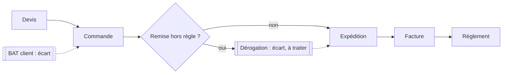
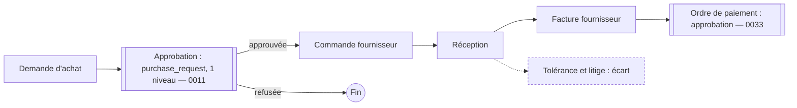
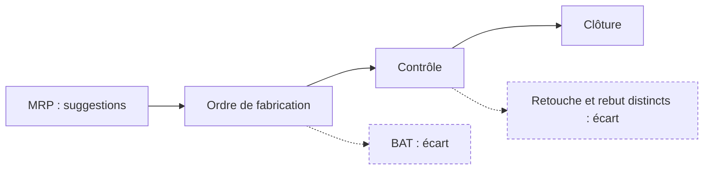
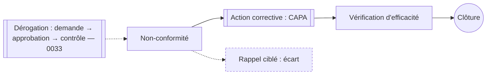
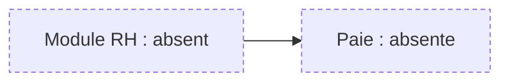
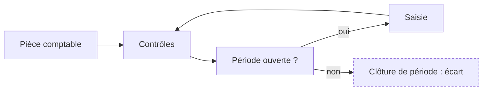
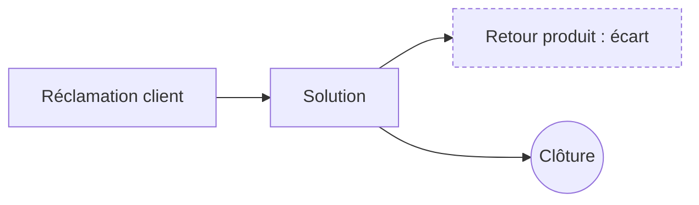
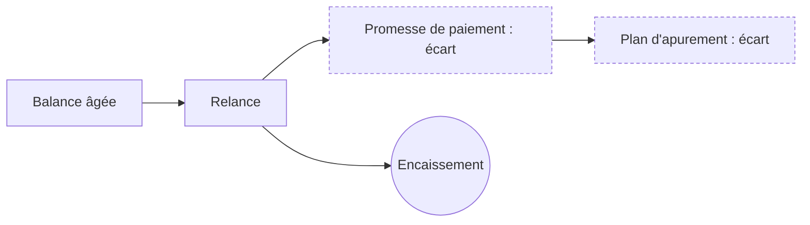
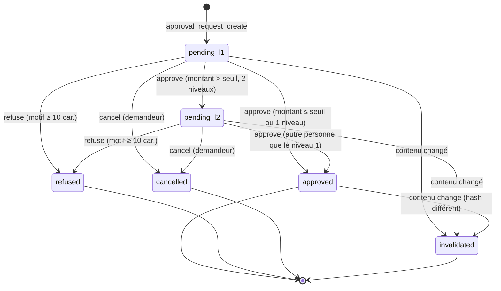

# Workflows ERP 360 — Mermaid (lot P019)

Source des huit workflows : `docs/MATRICE_ECARTS_CDC.md`, partie 8 (lignes 8.2 à 8.9). Le CDC complet
(`WORKMAN_ERP_360_CDC.md`) est hors dépôt : les étapes ci-dessous reprennent ce que la matrice énumère et ce
qui est réellement implémenté. Tout ce qui n'est pas vérifié dans le code est marqué **écart**.

Convention : les nœuds `[[Approbation]]` passent par le moteur d'approbation (migration 0043) ou par un circuit
existant (0011, 0018, 0033). Les pointillés signalent un écart.

BPMN formel : non produit. Le moteur choisi est une machine à états en base (PostgreSQL), pas un moteur BPMN.

---

## 8.2 Vente

Statut matrice : conforme hors BAT. Écart : BAT et dérogation de remise.

## 8.3 Achat

Statut matrice : partiel. Écart : tolérance de réception et litige. Le moteur P019 peut recevoir la demande d'achat
(objet `purchase_request`) après paramétrage de sa politique ; le circuit existant 0011 reste en service.

## 8.4 Production

Statut matrice : partiel. Écart : BAT, retouche et rebut distincts.

## 8.5 Qualité

Statut matrice : partiel. Écart : rappel ciblé.

## 8.6 RH et paie

Statut matrice : absent. Aucun workflow implémenté ; aucune règle de paie n'est codée (CLAUDE.md : pas de barème supposé).

## 8.7 Finance

Statut matrice : partiel. Écart : périodes et clôture.

## 8.8 SAV

Statut matrice : partiel. Écart : solution et retour.

## 8.9 Recouvrement

Statut matrice : partiel. Écarts : promesses et plans.

---

## Moteur d'approbation (P019, migration 0043)

Ce diagramme décrit le moteur ajouté dans ce lot, pas un workflow métier.

Transitions refusées (résultat `ok = false`, journalisées) : toute action sur un état final, auto-approbation du
demandeur (`SOD_SELF_APPROVAL`), second niveau par la même personne que le premier (`SOD_NOT_INDEPENDENT`),
escalade d'une demande non échue (`APPROVAL_NOT_OVERDUE`).
